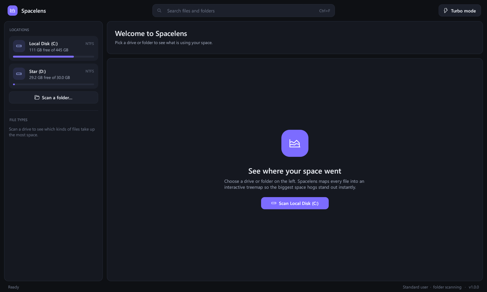

# Spacelens

A fast, modern disk space analyzer for Windows. It shows what is using space on your drives as a sortable folder table and an interactive treemap.



## Download

Get `Spacelens.exe` from the [latest release](../../releases/latest). There's no installer: double-click it to run. It works on Windows 10 and 11 (64-bit) and needs nothing else.

> The exe isn't code-signed, so on first launch Windows may say "Windows protected your PC". Click **More info → Run anyway**.

## Features

- **Turbo mode.** When run as administrator on NTFS drives, Spacelens reads the Master File Table straight from the disk, which takes a few seconds for a whole drive with over a million files.
- **Fast standard mode.** Without admin rights it uses a multi-threaded folder scan that works on any drive, including USB drives and network shares.
- **Interactive treemap.** Click to find an item in the table, double-click to zoom in, and hover for details.
- **File-type breakdown.** Sizes by category (videos, images, archives, apps, game data and more) and the top extensions.
- **Search** across every scanned file (Ctrl+F).
- **Actions.** Open, show in File Explorer, copy path, or move to the Recycle Bin (always asks first).
- Correct **size on disk** for compressed, sparse and online-only cloud files (OneDrive).
- Single portable `.exe` with Direct3D 12 / Vulkan rendering and no runtime dependencies.

### Keyboard

| Key | Action |
|---|---|
| ↑ ↓ PgUp PgDn Home End | Move selection |
| → / ← | Expand / collapse folder |
| Enter | Zoom treemap into the selected folder |
| Backspace | Zoom treemap out |
| Delete | Move selected item to the Recycle Bin |
| Ctrl+F | Search |

## Building from source

Requires [Rust](https://rustup.rs) (MSVC toolchain) and the Visual Studio C++ Build Tools.

```powershell
cargo build --release
# -> target\release\spacelens.exe
```

The C runtime is linked statically (see `.cargo/config.toml`), so the resulting exe runs on any Windows 10/11 PC.

## How it works

| File | Purpose |
|---|---|
| `src/mft.rs` | Reads the NTFS MFT from the raw volume and rebuilds the folder tree |
| `src/walk.rs` | Multi-threaded `FindFirstFileExW` fallback scanner |
| `src/tree.rs` | Compact arena tree with size aggregation and stats |
| `src/treemap.rs` | Squarified treemap layout baked into one GPU mesh |
| `src/app.rs` | The egui user interface |

## License

[MIT](LICENSE)
